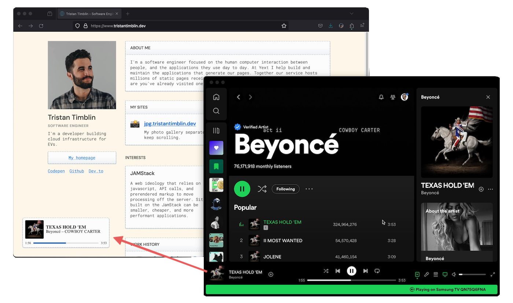

# spotify-stream-player



[Video Demo](https://x.com/tatimblin/status/1784282763547615440) | [Live Demo](https://www.tristantimblin.dev/) _(I have to be currently listening to music to see live)_

This project is an implementation of a read-only music player similar to the one on your phones lockscreen. It has two parts:

1. Streaming Server: The Spotify Rest API does not have support for event-based data detection. This server sits in between the Spotify and the client, it polls the Spotify API and detects changes to send to the client.
2. Custom Element: The front-end is a small dependency free custom HTML element. This allows for good portability by not tying it into any particular framework.

## Getting Started

### Spotify Authentication

I found Spotify to not have a great out of the box authentication solution for this particular use case. Understandably they are focused on supporting third-party sign-on where each user uses their own account. To obtain long-lived credentials for a particular account you can generate a refresh token (which doesn't expire), the SSE server then immediately uses that to generate a fresh access token.

1. Register a Spotify API app

[https://developer.spotify.com/dashboard](https://developer.spotify.com/dashboard)

Set the Redirect URI to: `http://localhost:3000`

2. Get your CLIENT_ID and CLIENT_SECRET:

From the Spotify dashboard visit the 'Settings' page. Under the 'Basic Information' tab note the 'Client ID'. Then, click 'Show client secret' and note the 'Client secret'. Save these somewhere they will be needed in later steps.

3. Sign-in using a browser

Visit the following page in your browser.
```
https://accounts.spotify.com/authorize?client_id=<CLIENT_ID>&response_type=code&redirect_uri=http%3A%2F%2Flocalhost:3000&scope=user-read-currently-playing%20user-read-recently-played
```

You should receieve a secret token in the address param under the `code` query param.

4. Encode your token

Use a [base64 encoding website](https://www.base64encode.org/) to generate your encryption certificate. Use this format `<CLIENT_ID>:<CLIENT_SECRET>`.

5. Obtain long-lived Refresh Token

In your terminal, run:
```
curl -H "Authorization: Basic <BASE64_CERTIFICATE>" -d grant_type=authorization_code -d code=<code> -d redirect_uri=http%3A%2F%2Flocalhost:3000 https://accounts.spotify.com/api/token
```

### Setup Server

You can deploy the SSE server wherever you like. I chose Google Cloud Run because it supports Server Sent Events, can handle 250 connections on one instance, and is short lived (15min). This suits my needs well of providing a non-critical feature that will be largely be idle.

```
gcloud run deploy spotify-stream-player --region us-east4 --source ./server
```

#### Configuration

The server takes several environment variables for configuration.

* PORT: The port to serve on. i.e. `8080`
* ORIGINS: comma-separated list of allowed origins. i.e. `https://tristantimblin.dev,localhost:5173`
* SPOTIFY_ID
* SPOTIFY_SECRET
* SPOTIFY_REFRESH

### Setup Client

#### Installation

The client can be installed from npm `npm i @tristimb/spotify-stream-player` or by downloading this repo and making your own build `npm run build`.

#### Usage

Import the package (it self-registers the `<spotify-player>` element):

##### js
```
import "@tristimb/spotify-stream-player";
```

Need the class (e.g. to register under a different tag name)? It's still the
default export:
```
import SpotifyPlayer from "@tristimb/spotify-stream-player";
customElements.define("my-player", SpotifyPlayer);
```

##### Styling

The component uses Shadow DOM and exposes a styling API via `::part()` selectors
and CSS custom properties. No external stylesheet import is needed — styles are
injected automatically and the player inherits your theme colors by default:

```css
/* Size the player and set theme colors via custom properties */
spotify-player {
  --ssp-accent: #1db954;           /* progress fill color */
  --ssp-radius: 8px;               /* border radius */
  --ssp-gap: 12px;                 /* spacing */
}

/* Style individual parts */
spotify-player::part(album) { border-radius: var(--ssp-radius); }
spotify-player::part(title) { font-size: 1.1em; font-weight: 700; }
spotify-player::part(artist) { opacity: 0.8; }
```

**Available parts:** `root`, `details`, `album` (art frame), `art` (image), 
`title`, `artist`, `album-text`, `progress`, `progress-bar`, `elapsed`, `remaining`.

**Custom properties:** `--ssp-accent` (progress fill), `--ssp-album-size`, 
`--ssp-gap`, `--ssp-radius`, `--ssp-progress-height` (progress bar thickness, 
default `4px`), `--ssp-title-size`, `--ssp-subtitle-size`, `--ssp-timestamp-size`, 
`--ssp-skeleton` (loading state tint), and more.

`--ssp-cover-color` is set automatically by the component: it samples the
current album art and exposes its dominant color as an `rgb(...)` value on the
host, updating on every track change. It falls back to a neutral color when the
cover cannot be read (e.g. the image CDN doesn't send CORS headers, so the
canvas is cross-origin-tainted). Read it in your own styles via
`var(--ssp-cover-color, <fallback>)`.

##### Album-tinted background

Add the boolean `tint` attribute to opt into a background derived from the
current album art (via `--ssp-cover-color`). The gradient is deliberately dark
and muted regardless of the album's own lightness/hue, so the light foreground
text always stays legible; without `tint` the default layouts are unaffected.

```html
<spotify-player src="http://localhost:8080/" layout="cover" tint></spotify-player>
```

##### Events

The component dispatches a `coverchange` `CustomEvent` whenever it extracts a
new dominant color from the album art. `event.detail` is `{ color }`, where
`color` is the same `rgb(...)` string set on `--ssp-cover-color`. It does not
fire when the cover cannot be read (cross-origin-tainted canvas).

```js
const player = document.querySelector("spotify-player");
player.addEventListener("coverchange", (e) => {
  console.log(e.detail.color); // e.g. "rgb(120 84 60)"
});
```

##### Layout

The `layout` attribute selects a built-in arrangement:

- `layout="row"` (default) — compact: small album thumbnail on the left, track
  info on the right, progress below.
- `layout="cover"` — art-forward (Apple Music style): a full-width square album
  cover on top, then title, artist, and progress stacked beneath it.

```html
<spotify-player src="http://localhost:8080/" layout="cover"></spotify-player>
```

Both layouts render from the same markup — only CSS differs. Because every piece
is an addressable `::part()`, you can also build a fully custom arrangement by
rearranging the parts with grid/flex from your own stylesheet (the bar and both
timestamps are flat siblings inside `progress`, so e.g. a bar-on-top with
timestamps at the ends below is pure CSS). Native `<progress>` is display-only
(no custom thumb/seek), and you can restyle or reorder the exposed parts but not
add new elements or change the nesting.

##### html
```
<!doctype html>
<html lang="en">
  <head>
    <title>My Website</title>
  </head>
  <body>
    <div id="app">
      <spotify-player src="http://localhost:8080/" layout="cover"></spotify-player>
    </div>
    <script type="module" src="/demo.ts"></script>
  </body>
</html>
```

##### Examples
- [Vite 5](https://github.com/tatimblin/spotify-stream-player/blob/main/client/index.html)
- [Vue 2](https://github.com/tatimblin/whois.timblin.io/blob/60f9cc66363fa6f808dfb687637f45456f0ec360/src/components/MusicPlayer.vue)

## Local Development

1. Start proxy server
  * `cd server`
  * `go run main.go`
2. Open a new tab in terminal
3. Start front-end server
  * `cd client`
  * `npm run dev`
4. Visit [localhost:5173](http://localhost:5173/)


## Deployment Notes

### Google Cloud Run

```
gcloud run deploy spotify-stream-player --region us-east4 --source ./server
```

### npm Package

```
npm version patch | minor | major
npm publish
```
